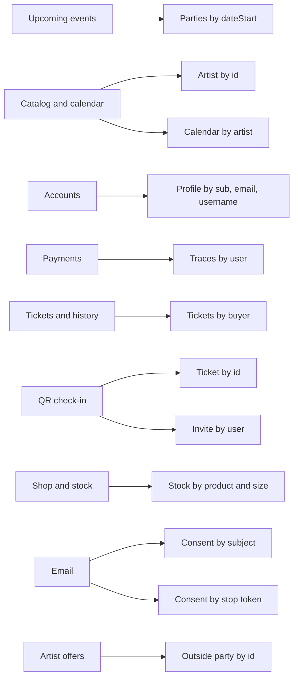

# Lookups

**Status:** planning only. These are the keys each feature reads by. Ticket 28 declares them with the schemas. The store is still JSON. When the owner confirms Amazon RDS for PostgreSQL, the same keys become indexes. This page does not create a database.

A lookup finds a row. A unique key also rejects a second row. A reference says the id must already exist. None of these keys authorize a read. The role rules still decide who may call them.

## By feature

| Feature | Ticket | Lookup | Unique | Who may use it |
| --- | --- | --- | --- | --- |
| Upcoming events | 08 | Parties with `dateStart` on or after today, oldest first. One party by `id`. | `Party.id` | Anyone. Published catalog only. |
| Shared catalog | 07 | Artist by `id`. Venue, partner, label, and agency by `id`. | Those ids | Anyone for the published files. Admin writes through the API. |
| Admin calendar | 18 | Calendar rows by `artistId`. Calendar rows by `partyId`. The party by `id`, including its offers. | `CalendarEntry.id`. One row per artist and party. | Admin. Door and user are denied the editor. |
| Accounts | 10 | Profile by Cognito `sub`. Profile by verified email. Profile by username. Provider subject within one provider. | `sub`, email, username, and provider plus provider subject | The signed-in person reads their own profile. Email match is how a second provider joins that profile. |
| Payments | 12 | Methods by `userId`. Trace by `id`. Traces by `userId`. | Method `id`. Trace `id`. | The buyer reads their own. An admin can read traces. The apps cannot set `confirmed`. |
| Tickets | 13 | Issued ticket by `id`, then compare the secret. Tickets by `buyerId`, newest first. | Ticket `id` | The buyer reads their own ticket. The secret is checked, not searched. |
| Purchase history | 26 | Orders by `userId`, newest first. The same buyer lookup as tickets. | Order `id` | The session user only. An id in the query does not switch accounts. Door and admin do not get this list. |
| Check-in | 14 | Invite by `userId`. Invite by email before the account exists. Check-ins by `ticketId`, newest first. | Invite `id`. Check-in `id`. | Door, and only for a party on that invite. |
| Shop store | 15 | Product by `id`. The product list. | Product `id` | Anyone can read the catalog. Buying requires a signed-in user. |
| Inventory | 16 | Stock by `productId` and size. Corrections by `productId` for the admin. | One stock row per product and size | The store reads the count. Admin writes it. Door and user cannot. |
| Email | 27 | Template by `id`. Consent by subject kind and subject id. Consent by `stopToken`. | Template `id`. One consent row per subject. `stopToken`. | Marketing sends only where consent exists and `stoppedAt` is empty. The stop link uses the token. |
| Artist offers | 22 | Outside party by `id`. Artist by `id`. | Outside-party `id`, disjoint from public party ids | Admin. The public events file is not a source for the outside-party id. |

Bookings uses the catalog and calendar lookups. It does not keep a second index. English and Portuguese are a field on the profile and on each template. They are not a lookup.

## References

These ids have to exist before the row is saved.

- A calendar row points at an artist id and a party id.
- An order line points at a party id or a product id.
- An issued ticket points at a party, a trace, and a buyer.
- A check-in points at a ticket and a party.
- A door invite's party ids are catalog parties.
- A stock row and a shop line point at a product id.
- An artist offer points at an outside party and a catalog artist.
- A payment method points at a billing address on the same profile.

## Keys that stay out

- The ticket secret is not a lookup. The scan loads the ticket by id and then compares the secret.
- A card number and a CVC are not fields, so they are not keys.
- There is no lookup that lists every customer. Ticket 26 refuses a team view of every order.
- Door and user have no lookup of other people's orders, tickets, or profiles.
- Marketing does not scan every profile email. It reads consent rows.
- A public party id is not a key into the outside-party list.

## Left out with the open questions

No index for a draft flag, a refund, a currency allow-list, a fulfillment method, a wallet pass, or offline check-in. Those records are not in the model yet.
