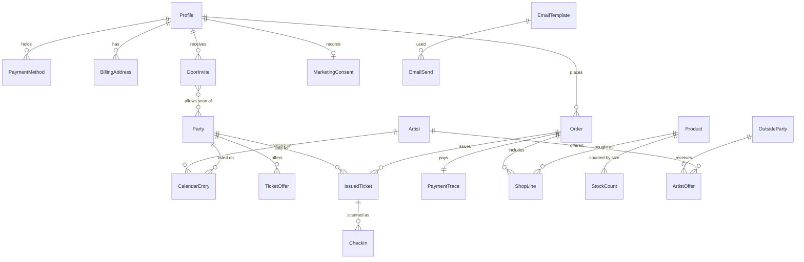
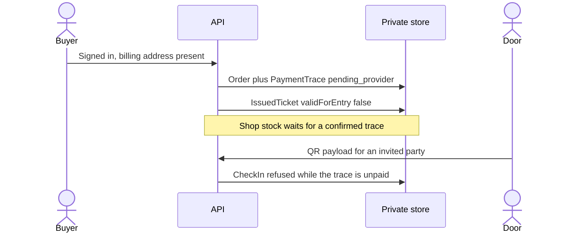

# Models

**Status:** planning only. This page names the records and the fields the tickets already require. The [lookups page](indexes.md) names the keys those features read by. Ticket 28 writes the schemas and those keys before the feature tickets. It does not add a database.

Two stores stay separate. The published catalog is what a visitor can read. The private store is what the API writes when someone registers, pays, enters, or is invited.

`OutsideParty` is a party that exists on the integrations list. It is not a `Party` on the public catalog. An artist offer points at one outside party and one catalog artist.

## Published catalog

These match the one-pager types in `src/lib/types/event.ts`, plus the fields later tickets add. The schema ticket copies the shape into the shared repo. It leaves `public/data` and `src/lib/types/event.ts` in place.

### Party

The public event. Ticket 07 treats today's fields as the contract. Ticket 18 adds the offer and the admin save.

| Field | Required | Source |
| --- | --- | --- |
| `id` | yes | current event |
| `title` | yes | current event |
| `type` | yes | current event types |
| `dateStart` | yes | current event |
| `dateEnd` | no | current event |
| `timezone` | no | current event |
| `durationHours` | no | current event |
| `venue` | yes | venue id, name, city, country, iso country, and the optional address, geo, and map URL |
| `lineupRaw` | no | current event |
| `stages` | yes | stage name, genres, artists |
| `cardArtists` | no | current event |
| `partnerIds` | no | current event |
| `timetableFestivalId` | no | current event |
| `media` | no | photo, video, and set links |
| `description` | no | current event, set by admin |
| `organizer` | no | current event |
| `images` | yes | banner and sizes. Admin sets the party image here. |
| `links` | yes | `goabase` required today. `eventbrite`, `tickets`, and Instagram stay. |
| `source` | yes | Goabase provider, id, and URL on refreshed events |
| `offers` | no | name and amount, from ticket 18. Currency is not defaulted to EUR. |

A draft flag is not a field yet. Ticket 07 still asks whether a party can stay off the public list. Until that answer, the public list is the events file.

### Artist

Today's artist on an event has name, and optionally country, country code, flag, genres, agencies, labels, and stage. Ticket 22 addresses an artist by id, so the shared artist schema also has `id`. The schema ticket does not rewrite `public/data/artists.json`.

### Venue, partner, label, agency

Keep the current shapes: venue as on the party, partner with id, name, city, handle, and Instagram, and label and agency as affiliation orgs with id and name. Social links stay the current id, platform, label, handle, and URL.

### Calendar entry

`id`, `artistId`, and `partyId`. Both ids must exist. What an agenda contains beyond an artist and their parties is still open, so the schema has no further agenda fields.

## Private records

These live in the private JSON from ticket 11. A published party schema rejects a ticket secret, a profile, and a payment trace.

### Profile

From ticket 10. Role is `admin`, `door`, or `user`. A new account is `user`.

| Group | Fields |
| --- | --- |
| Identity | Cognito `sub`, verified email, username, given name, family name, optional display name, avatar file key, optional phone in E.164 |
| Sign-in | provider `cognito`, `google`, or `apple`, plus that provider's subject. One profile can hold more than one provider. |
| Account | `createdAt`, `updatedAt`, status `active` or `disabled`, role, optional locale `en` or `pt` |
| Billing | address id, recipient name, line 1, optional line 2, city, region, postal code, country. One default address. |
| Payment methods | empty until a method is attached. The method shape is below. |

No password, no card number, and no date of birth.

### Payment method

`id`, type `card`, `apple_pay`, `google_pay`, or `other`, provider customer reference, provider method reference, brand, last 4, expiry month, expiry year, billing address id, status. A full card number or a CVC is invalid.

### Order and payment trace

An order has `id`, `userId`, purpose `tickets` or `shop`, lines, `traceId`, and `createdAt`.

A ticket line has `partyId`, offer name, and quantity. A shop line has `productId`, size, and quantity.

A trace has `id`, `userId`, amount, currency, purpose, reference, and status. The stub status is `pending_provider`. `providerReference` arrives only when a later adapter confirms the trace. The apps cannot set `confirmed`.

Currency is stored as given. The allowed list is still open on ticket 21, so the schema does not lock a currency and does not assume EUR.

`recordRefund` is an interface on ticket 12. Refund rules are open, so there is no refund record yet.

### Issued ticket

`id`, `partyId`, `traceId`, `buyerId`, `secret`, `createdAt`, and `validForEntry`. The QR payload is `id` plus `secret`. While the trace is `pending_provider`, `validForEntry` is false. The secret is not the public party id.

### Check-in

`id`, `ticketId`, `partyId`, `at`, `actorId`, and result `accepted` or `refused`. A refused row can include a reason: unknown, unpaid, wrong party, or already used. The actor is the invited door user.

### Door invite

`id`, email, optional `userId` once they have an account, `partyIds`, and `revoked`. It grants `door` for those parties only.

### Product and stock

A product has `id`, `name`, image path, alt, amount, currency when set, pickup copy, and stock note. The first products are `hw` and `pg`. Ticket 16 lets an admin add another, so `id` is a string, not a two-value enum.

A stock count is `productId`, size `P`, `M`, `G`, `GG`, or `2XL`, and `count`.

A stock correction has `id`, `productId`, size, `actorId`, `at`, `oldCount`, and `newCount`. The actor is an admin.

Pickup versus shipping is open, so fulfillment is the pickup copy already on the product and not a second method field.

### Marketing consent

`id`, subject kind `account` or `outsideParty`, `subjectId`, purpose, `consentedAt`, optional `stoppedAt`, and an unguessable `stopToken`. Registration does not create a consented row. The token is not the user id and not the party id.

### Email template and send

Templates are the seven messages in ticket 27. Each has `id`, purpose, `marketing` true or false, and subject plus body in `en` and in `pt`.

| Template id | Marketing |
| --- | --- |
| `registration` | no |
| `ticket-purchase` | no. The body carries the QR payload. |
| `shop-purchase` | no |
| `door-invite` | no |
| `new-party` | yes |
| `artist-offer` | yes |

A send log has `id`, `templateId`, recipient, language, purpose, and `at`. It is a stub record. It does not contain the ticket secret on a marketing template.

### Outside party and artist offer

An outside party has `id` and `name`. Saving one does not write `public/data/events.json`.

An artist offer has `id`, `outsidePartyId`, `artistId`, and the send id once ticket 27's sender records it. The public party id is not a valid `outsidePartyId`.

## How a purchase uses the records

Stopping marketing sets `stoppedAt` on the consent row. The next `new-party` or `artist-offer` send fails. A `ticket-purchase` send still succeeds.

## Left out until an open question is answered

- Agenda fields beyond artist and party.
- A draft flag on a party.
- A refund record.
- An allowed currency list.
- A fulfillment method beyond the pickup copy.
- A wallet pass beside the QR payload.
- Offline check-in.
- A fourth role.
