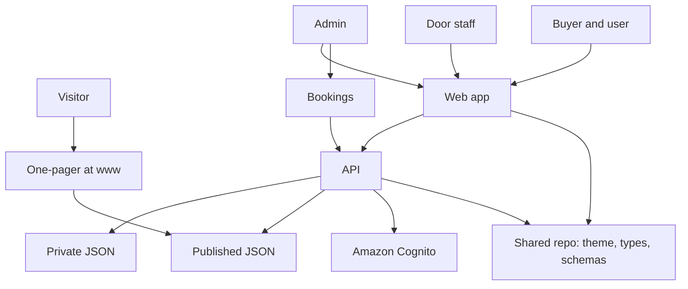
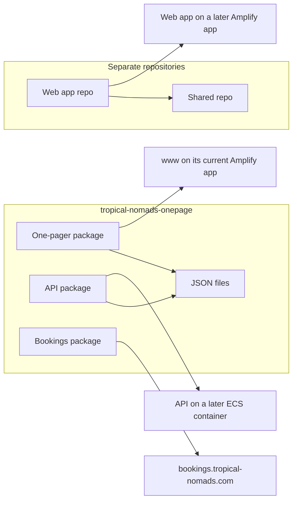
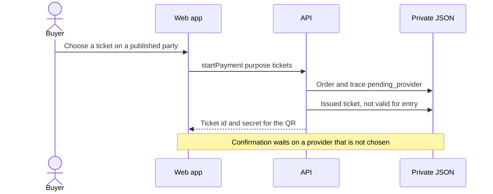

# System

**Status:** planning only. The hosts below are the decided targets. The Amplify app for the web app, the ECS service, and RDS are not created by these notes.

## How the product is wired

People use three fronts. The one-pager stays the public site. The web app is the product, including on a phone. Bookings is the admin calendar and the later integrations tab. All three meet at the API. The shared repository is the contract the clients and the API share. It is not a second database.

The one-pager reads the published files it already ships. It does not write tickets. The web app and Bookings write through the API. Cognito is the sign-in for the web app, with Google and Apple. Passwords stay in Cognito.

iOS and Android repositories are optional and last. If they are created, they call this API. They are not on this diagram because this plan does not give them screens.

## Deploys

`www.tropical-nomads.com` keeps the one-pager's existing Amplify app. The web app is a different Amplify app and is not live yet. The API is a Docker container on ECS and is not live yet. Bookings keeps its own address. `timetable.tropical-nomads.com` stays outside this diagram.

Amazon RDS for PostgreSQL is the database recommendation to confirm. Until that confirmation, the API's store is the JSON files. The recommendation does not move them.

## A ticket purchase, once the feature tickets exist

Check-in is a later call. Door staff scan the QR. The API reads the issued ticket and the trace, then writes a check-in. The web app does not declare the scan a success by itself.

## Security on this shape

- A visitor can read the published JSON. That read does not include profiles, traces, ticket secrets, invites, or stock counts.
- Admin writes parties, ticket offers, and shop through the API. Door writes a check-in for an invited party. A user reads their own orders and tickets.
- The shared repo holds shapes. The private JSON holds the secret values. Publishing the shared package does not publish a buyer's QR secret.
